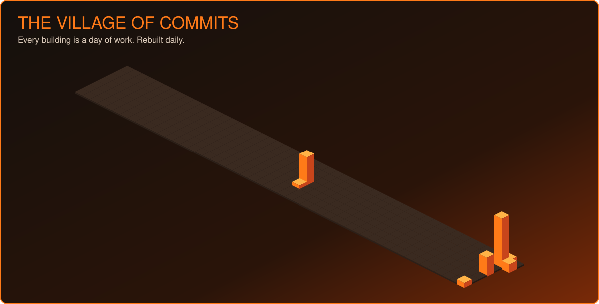

  
  

<h2>Mission board</h2>

<table>
  <tr><th>Rank</th><th>Mission</th><th>Briefing</th><th>Jutsu</th></tr>
  <tr><td align="center"><b>S</b></td><td><a href="https://github.com/gokuls456/straddlecore"><b>straddlecore</b></a></td><td>NIFTY options backtest studio with Telegram strategy signal alerts</td><td>Python</td></tr>
  <tr><td align="center"><b>A</b></td><td><a href="https://github.com/gokuls456/prompts-vault"><b>prompts-vault</b></a></td><td>A vault of prompts, sealed and ready</td><td>JavaScript</td></tr>
  <tr><td align="center"><b>B</b></td><td><a href="https://github.com/gokuls456/portfolio"><b>portfolio</b></a></td><td>My personal portfolio</td><td>JavaScript</td></tr>
  <tr><td align="center"><b>C</b></td><td><a href="https://github.com/gokuls456/course"><b>course</b></a></td><td>A course project</td><td>JavaScript</td></tr>
</table>

